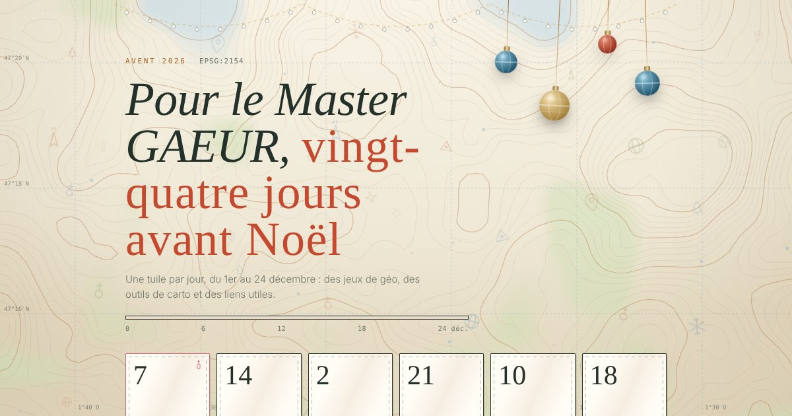

# L'Avent géomatique 🗺️

Calendrier de l'Avent 2026 pour le **Master GAEUR**. Du 1er au 24 décembre, une case s'ouvre chaque jour.

**👉 [Ouvrir le calendrier](https://fdosset9-ops.github.io/avent-geomatique/)**

---

## Le principe

- Une case (une « tuile ») s'ouvre chaque jour à minuit, du 1er au 24 décembre.
- Les cases des jours passés restent ouvrables : on peut rattraper son retard.
- Avant le 1er décembre, la page affiche un compte à rebours.
- Ta progression est gardée dans ton navigateur. Rien n'est envoyé nulle part.

Ce qu'il y a dans les cases ? Surprise. Le détail et les crédits arriveront ici après Noël. 🎄

## Comment c'est fait

Tout tient dans un seul fichier, `index.html` : HTML, CSS et JavaScript, sans framework et sans serveur. La page est hébergée avec GitHub Pages.

## Auteur

**François DOSSET**
M2 GAEUR · Cergy Paris Université · 2026
